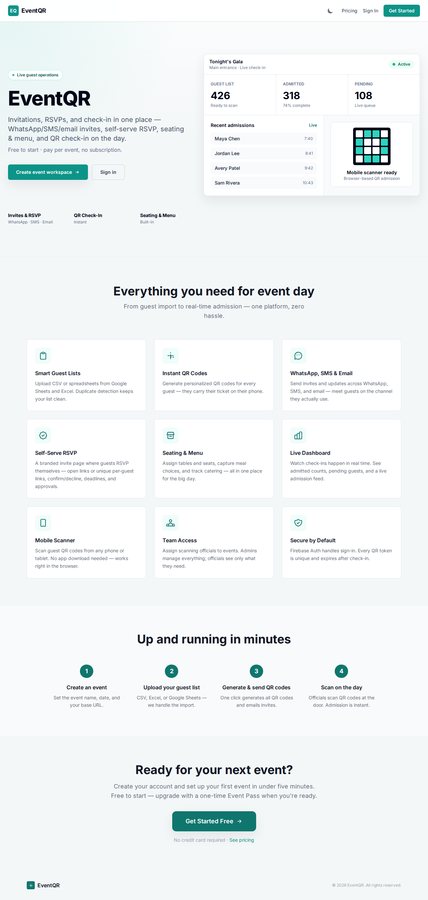
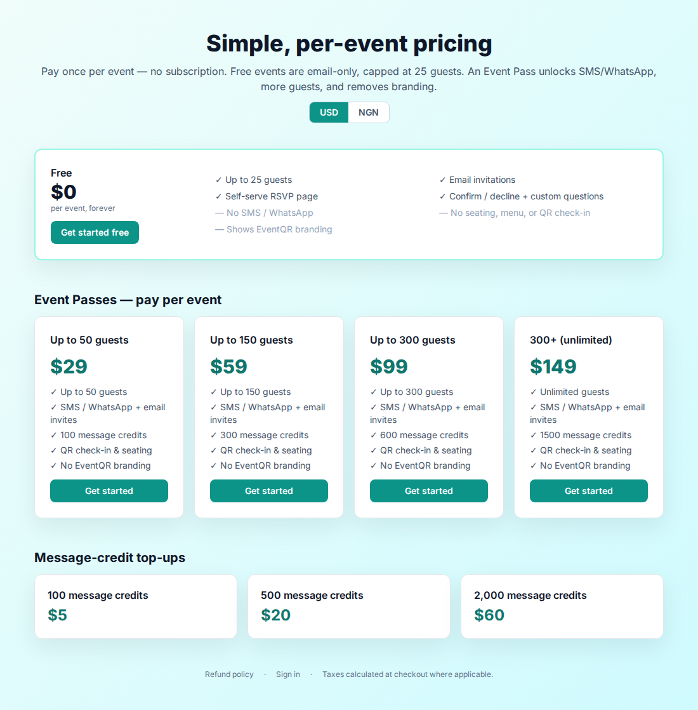
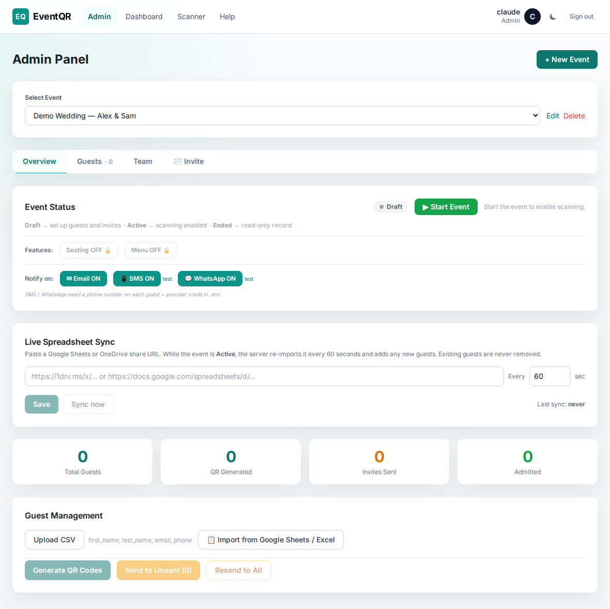
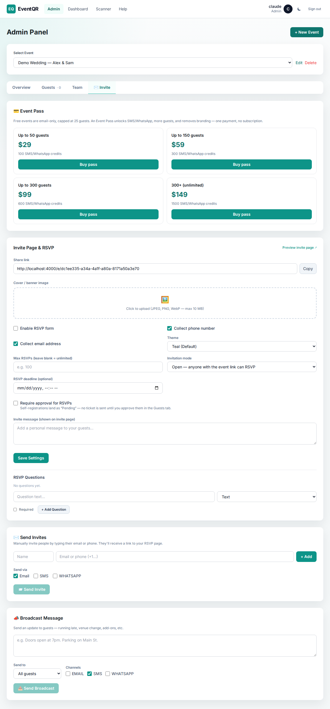
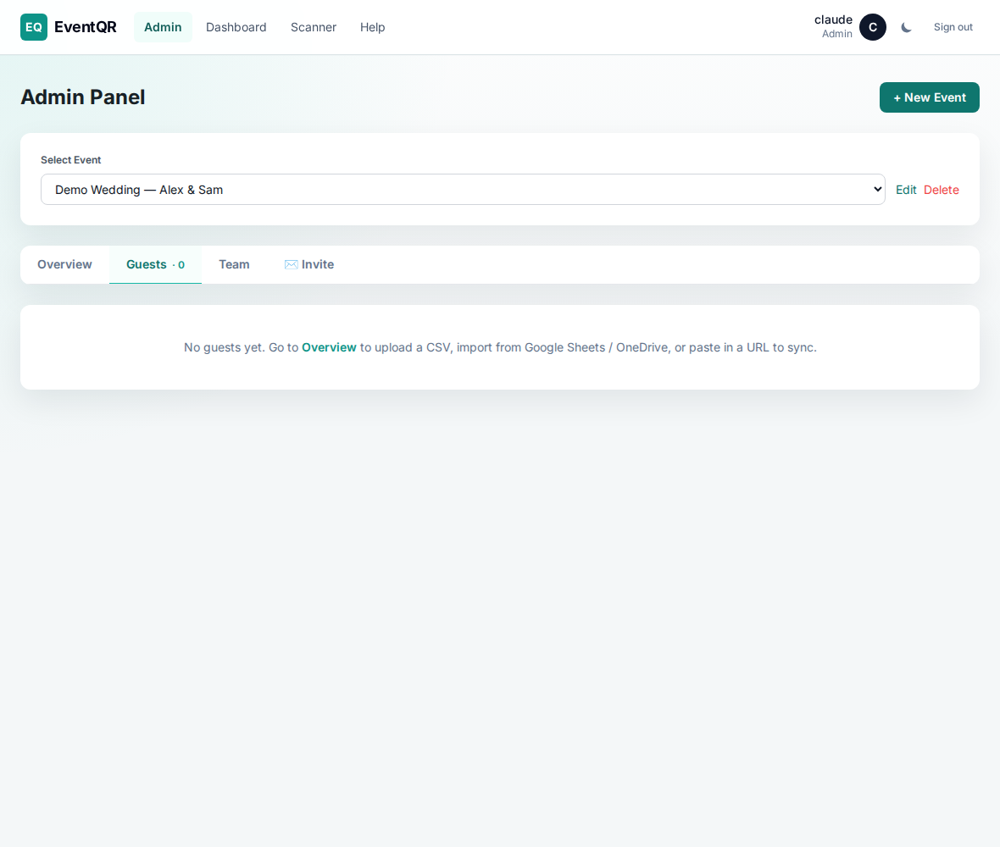
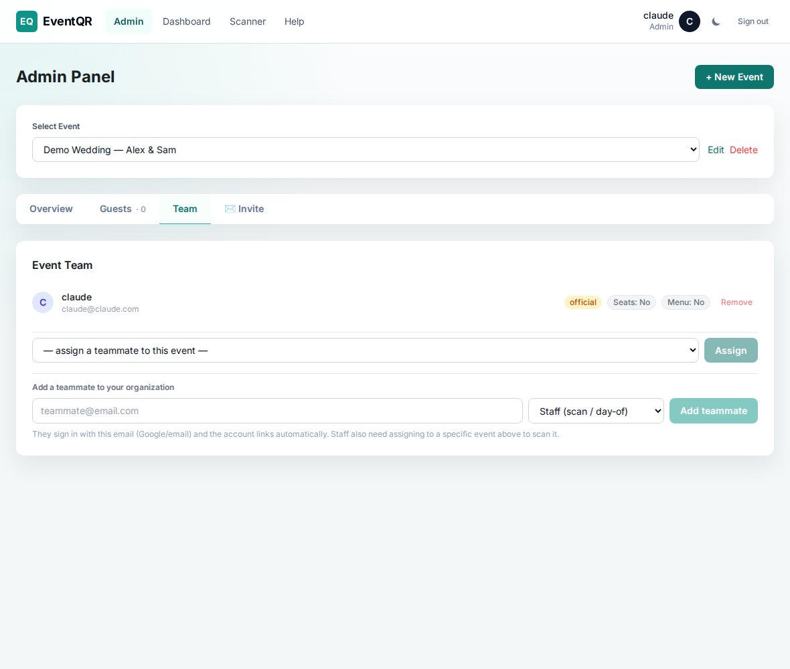
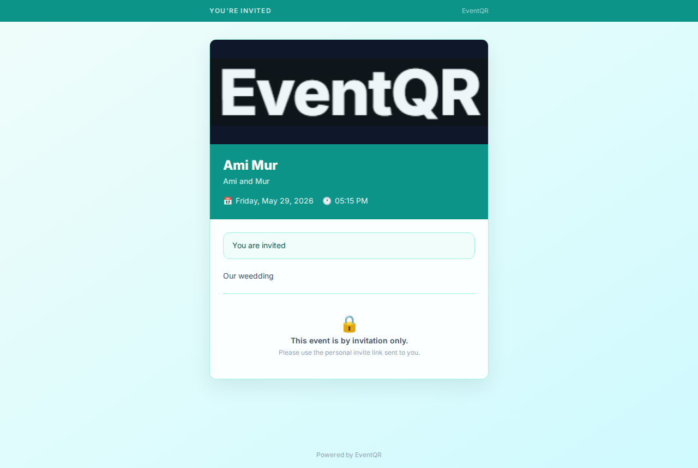
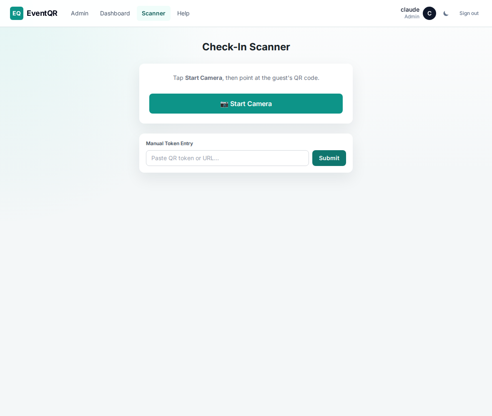

# EventQR — User Guide

Short, role-based instructions. Find your role and follow the steps.

- **Event organizer** — you run an event (create it, invite guests, check them in).
- **Staff / scanner** — you check guests in on the day.
- **Guest** — you received an invite.
- **Platform operator** — you run the EventQR platform itself.

Site: **https://events.vsgs.io**

---

## 1. Event organizer

### Get started
1. Go to the site → **Get Started** → sign in (Google or email).
2. You land in the **Admin** panel. You automatically get your own organization.

### Create your event
1. **Admin → New Event** → enter name, date, and details → save.
2. Open the event. You'll see tabs: **Overview, Guests, Team, Invite** (and **Seating / Menu** once enabled).

### Add your guest list
- **Overview tab** → upload a **CSV/Excel** or paste a **Google Sheets / OneDrive** link (columns: `first_name, last_name, email, phone`).
- Or add people one at a time in the **Guests tab**.
- Free events are limited to **25 guests**; an Event Pass raises this.

### Choose how people RSVP (Invite tab → "Invite Page & RSVP")
- **Open** — one shared link anyone can use to RSVP.
- **Closed** — invitation-only; each guest gets a **unique private link**.
- Optional: a **RSVP deadline**, and **require approval** (you approve each RSVP).
- Add a cover image, a message, and custom RSVP questions here too.

### Send invites
- **Open mode:** copy your event link (Invite tab → *Preview invite page*) and share it, or use **Manual invite** to send to specific emails/phones.
- **Closed mode:** use **Bulk RSVP invites** (Invite tab) — *Send to not-yet-invited*, *Remind no-reply*, or *Resend to all*. Each guest gets their personal link.
- Invites go by **email** on free events; **SMS/WhatsApp** need an Event Pass.

### Track responses
- **Guests tab** shows each person's RSVP status: **Attending / Declined / Pending / No reply**, and check-in status.
- If you turned on approval, approve/reject pending RSVPs there (or **Approve all**).

### Message everyone (Invite tab → Broadcast)
- Send an update (running late, venue change, etc.) to a target group: **All, RSVP Attending/Declined/No-reply, Checked-in, Not checked-in** — via email/SMS/WhatsApp.

### Seating & menu (paid feature)
- Turn on **Seating** / **Menu** in **Overview → Features** (requires an Event Pass).
- **Seating tab:** create tables, auto-assign or place guests, reserve seats.
- **Menu tab:** add menu categories/items; guests pick meals; track catering.

### Experience workflow
- Open **Team & settings → Experience** to create a guest journey workflow.
- Start with a workflow template such as **VIP dinner**, **Conference**, **Wedding reception**, or **Simple check-in**. You can also use **Create default workflow** or create a blank workflow.
- Common steps include **Main check-in**, **Seating assignment**, **Meal selection**, and custom operational tasks such as **Welcome pack collected**.
- Use **Consent form** to paste a waiver, media release, or event terms. Guests see it on their pass, type their signature, then can download HTML/PDF copies or email themselves a signed PDF copy.
- Publish the workflow when the event team should use it as the live runbook.
- Only one workflow can be live at a time. **Unpublish** returns a live workflow to draft, **Archive** stores a workflow out of live use, and **Unarchive** restores it as a draft.
- Use **Guest journey** to review one guest's progress and mark operational steps complete, blocked, skipped, failed, or overridden. Steps with prerequisites stay blocked until the prior steps are complete. The scanner also shows the guest's next available Experience steps after check-in and queues step completions if the device briefly goes offline.
- For offline general admission, select Prepare this scanner while online and confirm readiness and the 30-minute expiry. Keep the page open; eligible QR/manual admissions can be queued on that device. Reconnect, review server acceptance and resolve Needs review records. Do not plan offline guardian handoffs, daily/session attendance, checkout or section admission; disconnected scanners cannot share live occupancy or duplicate checks. See the current operating reference for limits.
- Use **Export progress** to download the workflow progress CSV for operations review.
- See a sample setup in [Festio Sample Experience Guide](FESTIO-SAMPLE-EXPERIENCE-GUIDE.md).

### Add your team
- **Team tab → "Add a teammate"**: enter their email + role (**Staff** to scan, **Admin** to manage). They sign in with that email and it links automatically.
- Then **assign** staff to the specific event (dropdown) so they can scan it.

### On the day — check-in
- Check-in requires an **Event Pass**. Set the event to **Active** (Overview).
- You or your staff open **Scanner**, scan each guest's QR — admission is instant.
- Watch it live in **Dashboard**.

### Upgrade (Event Pass) — Invite tab → "💳 Event Pass"
- A free event is email-only, 25 guests, no seating/menu/check-in, EventQR branding.
- **Buy a pass** to unlock SMS/WhatsApp, more guests, seating & menu, QR check-in, and to remove branding. One payment per event — no subscription.
- Running low on SMS/WhatsApp? Buy a **credit top-up** in the same panel.
- See plans any time at **/pricing**.

**Event overview** (status, features, guest import):

**Invite tab** (Event Pass, RSVP settings, broadcast):

**Guests** (RSVP status + check-in):

**Team** (add teammate + assign to event):

---

## 2. Staff / scanner

1. You'll get an email/message to join — sign in at the site with **that email**.
2. The organizer assigns you to an event.
3. Open **Scanner** → point your phone/tablet camera at each guest's QR code.
   - **Green / Welcome** = admitted.
   - **Already admitted** = ticket was used.
   - **Not assigned / needs pass** = ask the organizer.
4. No app to install — it works in the browser.

---

## 3. Guest

1. You'll receive an invite by **email, SMS, or WhatsApp** with a link.
2. Open it → fill in the **RSVP** form (and any questions) → **Confirm** (or **Can't make it**).
   - On a personal link you can change your answer until the deadline.
3. Once confirmed, your **ticket QR** is emailed to you.
4. On the day, show the **QR** (on your phone or printed) at the entrance.

The scanner (staff check-in):

---

## 4. Platform operator (EventQR admin)

Operator accounts see a **Console** link in the top nav (`/console`). Everyone else does not.

- **Overview** — every organization and its events, with plan and credit balance.
  - **Comp** an event onto a tier, or **add message credits**, with one click (no payment).
- **Pricing** — edit tiers and credit packs (label, price in USD/NGN, credits, guest cap, active). Changes show on the live pricing page and checkout immediately.
- **Operators** — add another operator by email, or revoke one. (You can't revoke yourself.)

To make someone an operator: **Console → Operators → add their email**. They get access on next sign-in.

---

## Screenshots

Images live in `docs/images/` (and the same set in `event-checkin/frontend/public/guide/`
for the in-app `/help` page). Public + admin/scanner shots use a demo event, so no
real guest data is shown. The operator Console is intentionally text-only here
(it lists real tenants). To refresh a shot, replace the file with the same name.

## Current operational procedures — reviewed October 6, 2026

This section supersedes conflicting earlier operational wording in this document. Availability depends on event settings, permissions and entitlement. It describes implemented behavior, not proof of venue readiness.

### Offline preparation and synchronization

1. While online and signed into the assigned Active event, open Check-in → Offline check-in readiness → Prepare this scanner. Confirm readiness, event, saved-pass count and expiry.
2. The version-2 manifest expires 30 minutes after download. It must match the selected event. Required admission workflow steps, section admission or a live seating decision can block offline admission.
3. Keep this browser page open and use one active tab per scanner. QR and manual convention admission can use eligible saved guests; manual lookup requires the event’s manual-check-in permission.
4. Read Check-in queued offline as a local saved record, not server acceptance. Same-device repeats are detected; another disconnected device cannot see this admission yet.
5. Reconnect and let synchronization run, or choose Sync / retry saved check-ins. Acknowledged admissions are removed from the pending queue; server rejection remains as Needs review.
6. Open Review saved check-ins, resolve the stated reason with an authorized lead and retry. Keep the page and browser data until every record is reconciled.
7. If storage fails, the manifest expires or the scanner says reconnect, stop offline admission. Follow the organizer’s outage procedure rather than bypassing the error.

**Important:** Offline cold start/reload, daily/session attendance, convention check-out and junior handoffs are not supported. Live consent, capacity and multiple disconnected devices need special planning; no venue-wide duplicate guarantee exists offline.

### Daily attendance and session entry/exit

1. Enable Daily attendance in Venue Access → Junior operations if required. A guest must already be admitted before today’s attendance can be recorded.
2. In Check-in choose Daily attendance, select the daily or session action, and use the camera/pass field or Manual search with the corresponding mode.
3. Daily attendance records one mark for the guest on the event-local date. Repeating it must report the existing mark rather than creating another. It does not perform general admission.
4. For a session select the correct session and entry or exit action. Server checks still enforce admission, age eligibility, time window and capacity.
5. An authorized supervisor may use Override and record entry for an age-eligibility exception with a reason. This does not bypass admission, session timing or capacity and is not a guardian-pickup override.
6. Review attendance and entry/exit records after the rehearsal. These actions require a connection.

### Junior Platform: authorized guardians and handoffs

1. Open Venue Access → Junior operations. Enable guardian verification for configured juniors and set the guardian designation scope.
2. Choose the junior, authorized guardian and relationship; save the authorization. Review whether each entry is Admin-authorized, Confirmed or Pending guardian confirmation.
3. At the scanner, attempt the junior’s zone entry/exit or check-out. When Guardian required appears, scan the authorized guardian’s pass.
4. If manual verification is enabled, staff can check the person’s identity and select the displayed authorized guardian. This records staff verification; it must not be described as a QR verification.
5. Review the entry/exit report with the guardian, operator and outcome. Configure each junior’s authorization; the setting alone does not create an authorization for every child.

**Important:** Guardian handoffs remain online. A name on a cached list, an age-group override or an unrelated adult pass cannot authorize a pickup.

### Multi-day timetable: rooms, speakers and age groups

1. Open Experience and the event’s active workflow. Configure each session’s date, start/end time, room, speaker and audience/age eligibility; enable the Live Program feature where required.
2. Publish the intended workflow and open a test guest’s GuestHub → Programme. The timetable shows all configured days with valid start/end times, not just the first three days.
3. Select each day and search by session, room, speaker or age group. Undated, disabled or invalid-duration sessions do not appear. Missing rooms display Room to be announced; missing speakers need organizer input.
4. Confirm event timezone and all days on a phone and desktop. A visible session is not proof that every guest meets its admission rules.
5. Create and title separate moderated Q&A activities for different speakers/sessions. Timetable speaker names do not automatically create or route Q&A queues.

**Important:** Timetable viewing is online. Publication does not prove conflict-free staffing, live capacity or guest eligibility; rehearse those separately.

### Ask the Sheikh: multiple questions and speaker queues

1. In Activity studio create Type Q&A and a distinct title containing the speaker/session. Enable Moderate text before it is public.
2. Open Presenter & moderator links and distribute the appropriate staff link securely. Keep guest join links separate.
3. Set the activity Live. Guests can filter Questions & answers only and search by activity/session title before opening the intended Q&A.
4. After submitting, guests use Ask another question to submit again. Q&A is not a one-answer-only quiz.
5. Moderators approve eligible questions before public display, then use Feature, Answered or Dismiss as appropriate. Rehearse the display to confirm unapproved questions stay private.
6. Close or clear the activity when the session ends. Do not assume a countdown or automatic correct-answer reveal applies to free-text Q&A.

### Festio Live: activities, Guided Show and display controls

1. Enable Festio Live for the event and confirm account entitlement. In Activity studio select New activity, enter Type, Title and Description, and add questions/options as appropriate.
2. For a Quiz mark the correct answer and configure question timing/scoring. Voting options are candidates or choices; voting has no objectively correct answer. Keep results hidden until the presenter reveals them.
3. Guests join from GuestHub or the supported join code/QR route. Only eligible/live activities appear; an open page is not proof the activity is accepting responses.
4. Choose an activity and Target display, then Send activity to screen. Use Show welcome / clear activity to remove it from that display.
5. For Guided Show configure automation and phase timings, then start the show. Rehearse answering, countdown, answer reveal and the next question. Auto-advance is conditional on automation being enabled; manual Next/Previous controls remain available.
6. An answer countdown needs an active timed question and server opening/deadline state. Simply selecting an activity or enabling Q&A does not create a quiz timer. Keep the control screen connected and verify the guest and display views.
7. Use Presenter & moderator links for the appropriate staff role. Protect these links. A guest join link is not a moderator link.
8. For Ask the Sheikh, follow the separate Q&A procedure. Rehearse two questions from one guest and moderation before making the activity live.

**Important:** Live responses, moderation, display updates and synchronized show controls require connectivity. Do not promise that Q&A automatically advances through fixed correct answers.

### FestioMe: guest community & groups

1. Enable FestioMe in Features & Channels and configure event community access. Open the organizer FestioMe workspace to manage groups, channels and moderation.
2. Guests enter through their own GuestHub → FestioMe link so the correct event and pass are retained. A copied link from a different event or environment may not authenticate them.
3. In guest Chats, use the plus/start-conversation control or More → Browse groups → New group. Choose people from the event and create an invite-only group. Group creation does not automatically invite every attendee.
4. Open Meetups, choose the intended group and create a meetup with its title, date/time, location and optional capacity. Members can view meetups and respond. A meetup response does not record venue or session admission.
5. Organizer group controls manage join policy, membership, channels and reports. Announcement channels are organizer posts and read-only for ordinary guests. Guests can use message reactions and the emoji picker in permitted conversations.
6. If an adult cannot enter, review the guest record and open organizer FestioMe → Settings → Guest chat access. Select Only approved adults and approve only people whose adult status you have confirmed. Do not bypass junior restrictions or use a staff identity as the guest. Confirm the correct event and pass before retrying.

**Important:** Community access, message permissions and guardian pickup authorization are separate. FestioMe needs connectivity; it is not an offline chat system.

### Broadcast an update

1. Open Guest Communication and the broadcast composer. Select the correct event before selecting recipients.
2. Choose an audience filter or explicit guests. Select recipients by ticket type selects a snapshot of the loaded guests, such as Teachers or Volunteers; review the selected names and count. An empty ticket-type selection must not be treated as All guests.
3. Write the message and select the enabled email, SMS or WhatsApp channels. Check contact details, applicable consent and the credit estimate before sending.
4. Review the message and recipients, then confirm the send. Queued means accepted for background processing, not delivered. Check delivery records for final channel status and failures.
5. Use Scheduler for a later update. Dynamic audiences are evaluated when sent; frozen audiences preserve the selected recipient set. Review event timezone, timing and status before scheduling.
6. Resolve the reason for failed delivery before retrying. Do not resend to everyone merely because some recipients failed.

**Important:** Sent messages cannot be recalled. Do not promise delivery when a job is only queued. Provider/network availability and messaging consent still apply.

## Additional implemented workspaces

### Conference Center: calls, tracks and operational records

1. Open Conference Center for the selected event. Use Calls & abstracts to enable the intended speaker, abstract, exhibitor or sponsor applications, set the deadline and review the public call link.
2. Review submissions and promote accepted people/organizations into the existing Speakers or Partners records. Acceptance alone does not schedule a session.
3. Define tracks and finish dated session scheduling in Experience. Coordinate delivery work in Planner and the speaker/partner workspaces.
4. Use organization templates to reuse the supported conference setup, then inspect the new event. Integration records describe connections; they are not proof that an external registration platform is synchronizing.

### Event website: content, FAQs and publication

1. Open Design Studio → Event website. Select a design and edit the event’s identity, registration details, venue/travel facts, navigation and FAQs.
2. Import the published Experience programme where offered, or configure the public schedule. Review every day, room, speaker and link before publishing.
3. Use preview to inspect phone and desktop layouts. Save draft does not publish; choose Publish when the content is ready.
4. Use Release history to inspect supported prior website releases; unpublishing takes the public website offline until published again. This website workflow is separate from the invite/pass design publisher.
5. Keep event FAQ answers factual: registration owner, eligibility, venue, contact route and deadlines must come from the organizer. Never publish personal pass URLs, staff links or guessed speaker details.

### Giving Hub, Donation Tracker and finance reconciliation

1. Open Festio Live → Donations and configure the campaign, goal, enabled payment instructions and donor privacy. Review the public Giving Hub and projector display.
2. Distinguish a pledge, a payment awaiting verification and confirmed received funds. Total potential is not the same as confirmed money received.
3. Use the finance workspace Payments & pledges to review evidence and confirm or reject contributions with event-admin access. Confirmations are audited.
4. Verify public and projector totals after reconciliation. Do not confirm an amount merely because a guest submitted it.
5. Gift-list coordination, donations and ticket sales use different workflows. Check the configured channel/payment process before telling a guest that Festio itself processed a payment.

### Session materials and presenter resources

1. Open Festio Live → Materials. Add the supported file or link, title and session association. Review who can access the material before release.
2. Select the presentation display and test the actual resource there. Verify page movement and blackout controls where supported by the material type.
3. Release approved resources to guests only when intended; an uploaded private file should not be assumed visible in GuestHub.
4. Keep presenter/display access separate from guest resource links. Rehearse external links and supported formats on the venue equipment.

### Certificates: eligibility, issuance and verification

1. Open Festio Live → Certificates. Create or select a certificate template and configure the supported eligibility rules and design.
2. Use a fictional eligible guest for a test issuance. Confirm the rendered identity, event details and public verification link before batch issuance.
3. Review issued records and use supported revocation controls when a certificate should no longer be valid. Check the public verification page after a change.
4. Do not interpret a certificate as evidence of attendance beyond the actual eligibility rules and recorded data.

### Academy: assignments, practical evidence and versioned learning

1. Open Academy and select the correct organization. Lessons are filtered by the learner’s role; managers have additional setup and management procedures.
2. Complete each lesson’s steps, answer the quiz and submit practical evidence when requested. Passing a quiz is distinct from manager approval of practical work.
3. Authorized managers can assign learning, review evidence, manage due dates and inspect progress. Use reminders only for the intended recipients.
4. Curriculum version 3 contains the October 2026 operational updates. Earlier version-2 records remain historical; a version change does not mean those learners completed the new material.
5. Coordinate reassignment and release review with the training owner. Do not reset or delete historical progress simply to refresh documentation.
